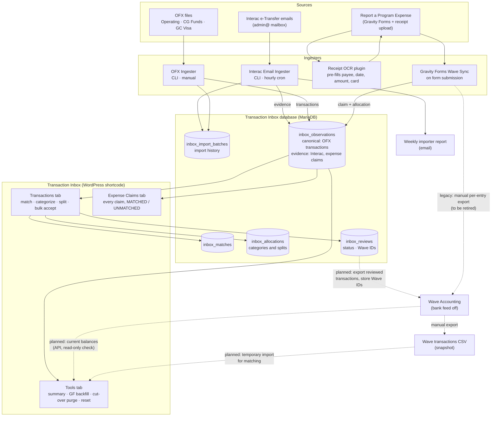

# Scout Accounting Toolkit

Scout Accounting Toolkit is a collection of open-source tools designed to help Scout groups manage payments, banking transactions, expense claims, and accounting workflows using low-cost and volunteer-friendly systems. 

I am a Scouter and sysadmin in Toronto, Ontario, Canada. The project was originally developed for the 403rd Toronto Sea Scout Group but is being generalized for use by other Scout groups and volunteer organizations.

## License

Scout Accounting Toolkit is licensed under the GNU General Public License v3.0 (GPL-3.0). See the LICENSE file for the full license text.

Many volunteer organizations lack the resources to purchase expensive accounting and workflow software. This project aims to provide a practical, transparent, and community-driven alternative. Contributions, fixes, and improvements should remain available to the wider community, which is why Scout Accounting Toolkit uses the GPL rather than a more permissive license. The GPL ensures that improvements and derivative works remain available to the wider community.

## Why this project exists

Many Scout groups collect information and money through multiple disconnected systems:

- Bank accounts
- Credit cards
- Interac e-Transfers
- Online forms
- Expense claims
- Accounting software

Volunteer treasurers often spend significant time manually reconciling these systems.

Scout Accounting Toolkit provides tools to:

- Import transactions automatically
- Collect supporting evidence
- Review and categorize transactions
- Track allocations and claim matching
- Prepare data for accounting systems

## Design Goals
 - Volunteer-friendly (though it may require a bit of help from a more technically minded Scout or Scouter to get set up)
 - Low cost (We use free tools as much as possible and are not charging you for this code)
 - Open Source (I'm a staunch advocate of Free/Libre principles and supporter of the Free Software Foundation)
 - Auditability (I try to preserve everything)
 - Security-consciousness
 - Minimal duplication of information
 - Simple deployment (unfortunately it requires the setup of at least two API keys, but I'm doing my best to keep it simple)

## Workflow assumptions

Like every organizations the 403rd Toronto has made operational choices based on habit, immediate needs, volunteer familiarity, and cost. I outline our choices below, not because they're the only way to go, but because they relate to our choices to reduce volunteer labour and support this workflow. You can certainly take and modify the code to work in other ways and are free to ask for tweaks to support your setup, but radical departures from this workflow may not be realistic.

### Wave Accounting
We use Wave as our accounting software. It has a free level that is probably fine for most Scout groups. We pay for the receipt processor add-on.

### Interac Transfers - IN and OUT
This is one critical piece of tracking income and reducing admin overhead for us. Collecting cash and writing cheques are both labour intensive and fraught with possibilities for error. I have heard from many Scouters that their bank has told them that it can't be done. That may be true for their banks and for their account type.
We use Alterna Savings (https://alterna.ca), a credit union that is available across much of Ontario. We have "two-signer" controls on both cheques and on outbound e-transfers. We can accept inbound e-transfers at up to 100 e-mail addresses. This lets us segment income easily by section. In theory we could use more segments, but that would likely create confusion for parents and increase errors. See BANKS.md for a list of banks known to support inbound and outbound Interac e-transfers.

### Credit Card
Really. This seemed impossible to us when we started, but was easier than we expected. Our credit union helped sort it out. This was as big a game-changer as getting inbound and outbound e-transfers. You need to be sure this is a proper organizational one and not one that is backed by an individual member. You will need solid deposit history with your bank to navigate this. This is certainly not required, but is one of the work flows we navigate using Gravity forms otherwaise the sea of transactions would be overwhelming. If you sign up for CGaming, you will need to get a credit card to be able to most usefully take advantage of the funding as you cannot reimburse members from the CGaming account.

### Gravity Forms
We use Gravity Forms on WordPress to file expenses from Scouters. All expenses must be sent through this interface so that data can be regularized for input into Wave without manual intervention. Our form will take a receipt (photo or pdf), take a stab at making sense of the contents, and ask the user to complete the rest, choosing the correct expense category (e.g. Cubs, Group Gear, Uniforms, Transportation, ...).

### Transaction files

## Current Components

### Interac Email Ingestion

Imports incoming Interac payment notifications from a mailbox and stores them in a transaction inbox.

Capabilities:

- IMAP mailbox processing
- Duplicate detection
- Payment extraction
- Import batch tracking
- Transaction observation storage

### OFX Bank Ingestion

Imports OFX exports from supported banks and credit card providers.

Capabilities:

- OFX parsing
- Batch import management
- Transaction normalization
- Duplicate detection
- Unified inbox integration

### Transaction Inbox

WordPress-based transaction review system.

Capabilities:

- Transaction review
- Expense claim matching
- Transaction categorization
- Split allocations
- Batch acceptance workflows
- Receipt evidence display

### Transaction Inbox Tools

Administrative and operational utilities for transaction review and maintenance.

### Gravity Forms Wave Sync

Integrates Gravity Forms submissions with accounting workflows.

Capabilities:

- Wave account discovery
- Mapping of form categories to accounting accounts
- Expense evidence capture
- Manual Wave export workflows
- Transaction Inbox integration

## Architecture

## Architecture

