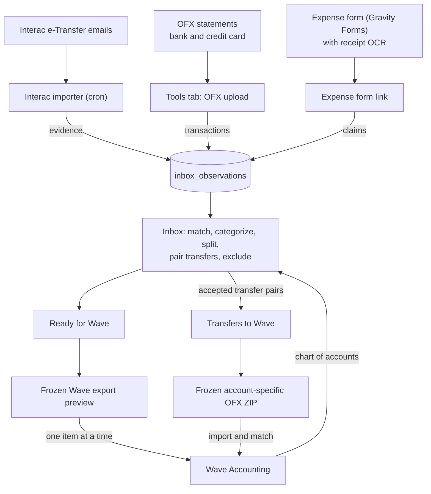

# Scout Accounting Toolkit (SAT)

Gets a Scout group's money records into Wave Accounting with less manual work. Bank and credit-card statements, Interac e-Transfer notifications and volunteer expense claims all land in one **transaction inbox**, where they are matched, categorized and reviewed before they go to Wave.

## Parts

| Part | Where | What it does |
|---|---|---|
| WordPress plugin | `wordpress/scout-accounting-toolkit/` | The inbox (shortcode `[sat_inbox]`), Tools tab, expense form link, receipt OCR, Wave connection, settings |
| Interac importer | `ingest/interac-email/process.php` | Hourly cron. Reads e-Transfer notification emails and adds them to the inbox as evidence |
| Weekly report | `ingest/interac-email/weekly-report.php` | Weekly cron. Emails a summary of imported e-Transfers with data-quality checks |
| Database | `database/migrations/` | Tables used by everything above (a separate database from WordPress) |

## Architecture

## How the inbox works

- **Transactions** come from OFX statements. **Evidence** explains them: e-Transfers for deposits, expense claims for payments, and the other side of transfers between your own accounts.
- Suggested matches appear under each transaction. Accepting claims or a transfer fills in the categories.
- A transaction is **ready** when its category lines add up to its amount. Views: Needs attention, Ready for Wave, Excluded, All. Filters: account, income/expenses, month.
- **Exclude** (with a reason) keeps something out of Wave for good: duplicates, tests, items entered in Wave by hand.
- Accepted transfers between configured payment accounts appear once in **Transfers to Wave**, separate from Ready for Wave.
- Categories are the Wave chart of accounts, fetched from Wave.

## Expense Claims

- Every claim is listed whether or not it is matched. Bookmarkable filters: month (by Expense Date), claimant, payment method and match status. Sorting: Expense Date, Submission Date, claimant, vendor or amount.
- **CG Funds monthly report** lists the claims of one calendar month, excluding only Reimburse a Scouter. It does not infer which account funded a claim, so review the CSV for non-CGaming exceptions. **Download receipts ZIP** builds `CGaming expenses - <Month> <Year>.zip` privately: the CSV plus exactly one receipt per claim. It refuses the whole report if any claim lacks exactly one readable local receipt.
- On the expense form, Invoice and Credit Card claims accept exactly one receipt; Reimburse a Scouter claims accept several. Gravity Forms validation enforces this on the server.

## Wave export

- Select transactions in **Ready for Wave** to create a persistent preview batch. The business, source transactions, accounts, splits, descriptions, notes and amounts are frozen into SAT-owned audit tables.
- Descriptions and complementary notes stay editable until each item is exported. Default notes identify supporting claims or Interac evidence without repeating the bank description.
- Matched transfers are excluded from Wave API previews and handled only through the dedicated transfer OFX workflow.
- Validation checks the selected business, token, active Wave account IDs, dates, amounts, balancing and source status.
- **Export one** sends one direct Wave mutation. **Send all ready items to Wave** uses that same path sequentially in preview order, skipping exported items and stopping on the first failure. Deterministic external IDs are reused on retry; successes and failures are independent, and interrupted attempts become retryable after checking the outcome in Wave.
- Batch history includes attempt results plus preview and result CSV downloads.
- Cleanup and reset refuse transactions owned by exports and their matched evidence; they do not erase export audit history.

## Transfer OFX

Accepted transfer matches that satisfy the configured-account, opposite-amount, currency and uniqueness checks are listed once per pair in **Transfers to Wave**. Create a frozen batch to generate an account-specific OFX file for every affected account, packaged with a plain-text manifest in a ZIP. Import each file into its corresponding Wave account and match both transaction legs as a transfer before explicitly confirming the batch. Partial imports may be finished later; confirm only when every transfer in the batch is imported and matched. Generated batches can be re-downloaded, or cancelled only if nothing from them is in Wave (none imported, or every imported transaction deleted). Confirmed and cancelled batches remain in audit history. Accepted payment-account transfers that fail OFX eligibility are listed under **Needs attention** with the reason and never fall back to the Wave API.

Transfers are never submitted through the Wave API. The complete fresh-install schema, including transfer batches, is defined in `database/migrations/001-install.sql`. Development databases created from the original 001 schema can be advanced with `database/migrations/002-transfer-ofx-batches.sql`; fresh installs should run 001 only.

The Wave API workflow intentionally excludes scheduled export, tax handling, customer/vendor matching, receipt upload to Wave, updates or deletion of existing Wave transactions and bulk API mutation. Accepted transfers use the separate transfer-OFX workflow above. See [docs/WAVE_EXPORT.md](docs/WAVE_EXPORT.md).

## Getting started

See [docs/INSTALL.md](docs/INSTALL.md) for installation and [docs/UPGRADING.md](docs/UPGRADING.md) for the current development database-schema workflow.

For commit-identified plugin packages and read-only installed-code verification, see [docs/RELEASING.md](docs/RELEASING.md).

## Requirements

PHP 8.0+, MariaDB/MySQL, WordPress 6.0+. The PHP ZipArchive extension is required for transfer OFX and CGaming report ZIP downloads, and fileinfo for CGaming receipt checks. Gravity Forms for expense claims. Tesseract and pdftoppm for receipt OCR. The PHP IMAP extension for the Interac importer.

## Licence

GPL-3.0-or-later.
