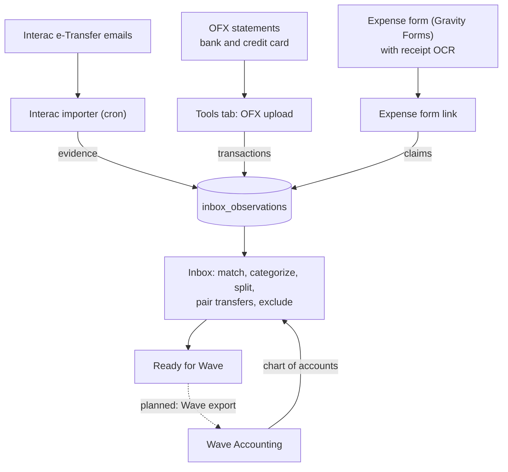

# Scout Accounting Toolkit (SAT)

Gets a Scout group's money records into Wave Accounting with less manual work. Bank and credit-card statements, Interac e-Transfer notifications and volunteer expense claims all land in one **transaction inbox**, where they are matched, categorized and reviewed before they go to Wave.

## Parts

| Part | Where | What it does |
|---|---|---|
| WordPress plugin | `wordpress/scout-accounting-toolkit/` | The inbox (shortcode `[sat_inbox]`), Tools tab, expense form link, receipt OCR, Wave connection, settings |
| Interac importer | `ingest/interac-email/process.php` | Hourly cron. Reads e-Transfer notification emails and adds them to the inbox as evidence |
| Weekly report | `ingest/interac-email/weekly-report.php` | Weekly cron. Emails a summary of imported e-Transfers with data-quality checks |
| Database | `database/migrations/` | Tables used by everything above (a separate database from WordPress) |

## Architecture

## How the inbox works

- **Transactions** come from OFX statements. **Evidence** explains them: e-Transfers for deposits, expense claims for payments, and the other side of transfers between your own accounts.
- Suggested matches appear under each transaction. Accepting claims or a transfer fills in the categories.
- A transaction is **ready** when its category lines add up to its amount. Views: Needs attention, Ready for Wave, Excluded, All. Filters: account, income/expenses, month.
- **Exclude** (with a reason) keeps something out of Wave for good: duplicates, tests, items entered in Wave by hand.
- Categories are the Wave chart of accounts, fetched from Wave.

## Getting started

See [docs/INSTALL.md](docs/INSTALL.md). Upgrading from the separate 0.x plugins: [docs/UPGRADING.md](docs/UPGRADING.md).

## Requirements

PHP 8.0+, MariaDB/MySQL, WordPress 6.0+. Gravity Forms for expense claims. Tesseract and pdftoppm for receipt OCR. The PHP IMAP extension for the Interac importer.

## Licence

GPL-3.0-or-later.
